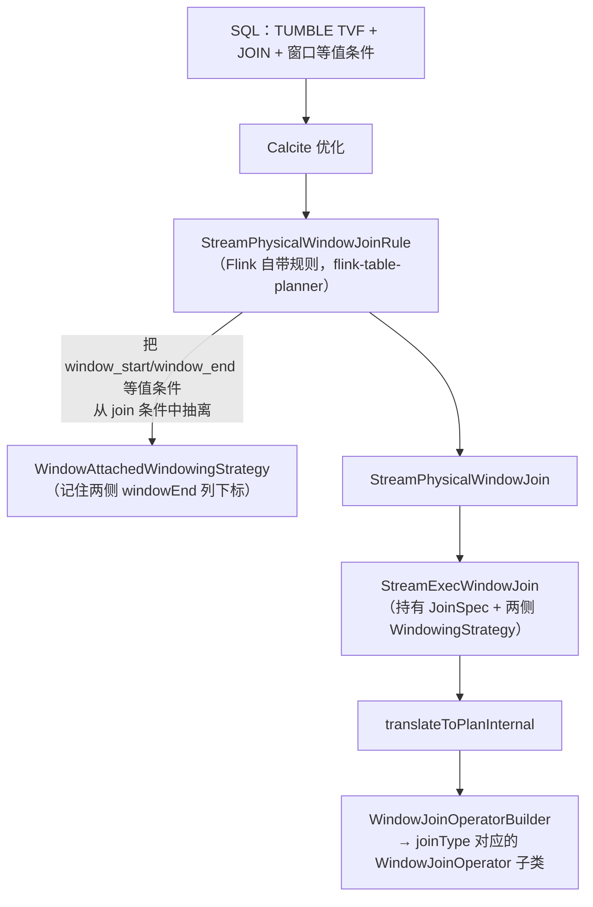
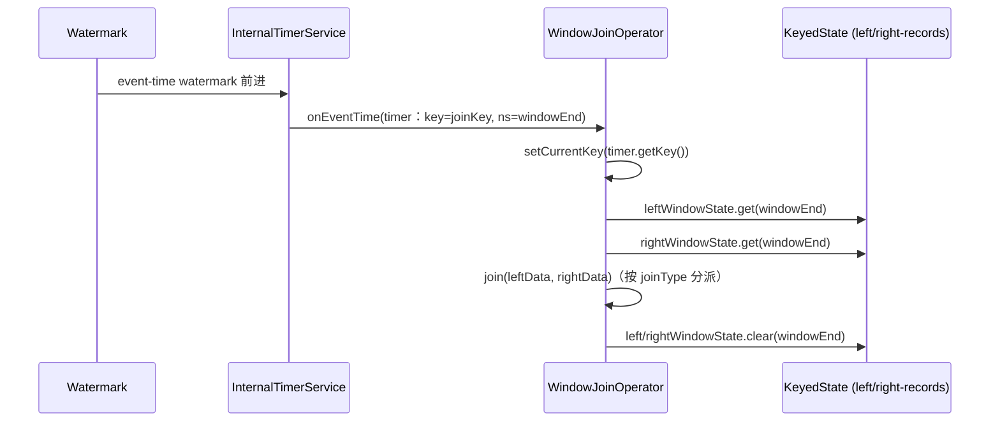
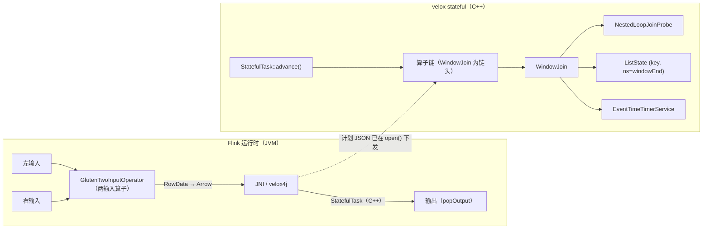
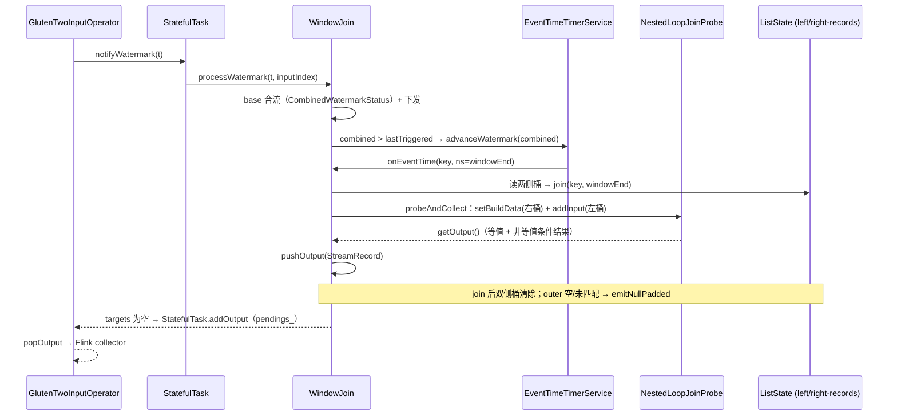

# Flink WindowJoin：原生执行流程与 GFV 覆盖执行流程

> 面向团队的 WindowJoin 算子分享文档。
> 原生侧基于 Flink 1.19.2（`flink-table-runtime` / `flink-table-planner` 源码）；
> GFV 侧基于当前三仓 windowjoin 开发分支（velox `expression-dev-windowjoin`、velox4j `pin-velox-windowjoin`、gluten `expression-dev-windowjoin`）。

## 0. 通俗版导读：一条 SQL 的两条路

**一句话总纲——同一张图纸、两支施工队**：SQL 在"规划"阶段完全共用 Flink 的大脑，到"把图纸变成算子"这一步分家：原生派 Java 工人，GFV 换 C++ 工人，最后在同一个 Web UI 汇合验收。

### ① 认图阶段——完全共用（两边 UI 算子名一模一样的原因）

SQL 进来后，Flink 的规则 **`StreamPhysicalWindowJoinRule`** 认出"两侧窗口相同 + 窗口等值"的 join 形态，把 `window_start = window_end` 条件抽走装进 `WindowingStrategy`，产出计划节点 **`StreamExecWindowJoin`**。这一步 GFV **一个字都不改**——所以两个 Web UI 里看到逐字相同的 `LocalWindowAggregate → GlobalWindowAggregate → WindowJoin → Sink`。

### ② 分家点——`translateToPlanInternal`（同一个方法名，两种命运）

- **原生**：调 `WindowJoinOperatorBuilder`，造出纯 Java 算子 **`WindowJoinOperator`**（按 join 类型选 Inner/LeftOuter/FullOuter/... 子类），直接进集群。
- **GFV**：gluten 里放了一份**同名副本** `StreamExecWindowJoin`（连类全名都一样），它的 `translateToPlanInternal` 干的是"翻译"：`Utils.toVLJoinType` 翻 join 类型，`Utils.generateJoinEqualCondition` + `convertNonEquiCondition`（经 `RexNodeConverter`）翻 join 条件，组装 **`StreamWindowJoinNode`**（velox4j 计划节点）+ **`NestedLoopJoinNode`**（join 计算内核的子计划），序列化成 JSON 下发。

### ③ GFV 的桥——JVM 壳 + JNI

**`GlutenTwoInputOperator`** 是留在 Flink 世界的"壳"：`open()` 把计划 JSON 递给 native 建 **`StatefulTask`**；每批数据 `task.advance()`（拉模型）；每个 watermark `task.notifyWatermark()`。C++ 侧 **`StatefulPlanner::transformStreamWindowJoinOperator`** 把 JSON 还原成算子链。

### ④ GFV 的芯——velox `WindowJoin`（C++）真正干活

- 数据按 `(join key, windowEnd)` 装桶进 **`ListState`**，`registerEventTimeTimer(key, windowEnd, windowEnd-1)` 上闹钟
- watermark 推进：`CombinedWatermarkStatus` 合流 → **`EventTimeTimerService::advanceWatermark`** → 闹钟到点 → `onEventTime` → `join(key, windowEnd)`
- **join 计算是委托的**：交给 velox 现成的 **`NestedLoopJoinProbe`**（`setBuildData` 放右桶、`addInput` 喂左桶、`getOutput` 收结果）——"复用向量化内核"的落点
- 迟到行 `filterWindowFiredRows` 丢、outer 空桶 `emitNullPadded` 补 null、结果 `pushOutput` → Java 侧 `popOutput` 取走

### 关键类对照

| 职责 | Flink 原生 | GFV |
|---|---|---|
| 认图规则 | `StreamPhysicalWindowJoinRule` | **同一个**（共用） |
| 计划节点 | `StreamExecWindowJoin` | **同名副本**（gluten 里） |
| 造算子 | `WindowJoinOperatorBuilder` | 翻译成 `StreamWindowJoinNode` JSON |
| 运行载体 | `WindowJoinOperator`（本体） | `GlutenTwoInputOperator`（壳）+ `StatefulTask`（芯） |
| 状态 | `WindowListState`，key=join key，ns=window | `ListState`，key=key-group，ns=windowEnd |
| 闹钟 | `SlicingWindowTimerService` | `EventTimeTimerService` |
| join 计算 | `join()` 双层循环 + `JoinedRowData` | `NestedLoopJoinProbe`（向量化内核） |
| 迟到判定 | `isWindowFired` | `filterWindowFiredRows`（精确对齐它） |
| 补 null | `GenericRowData` 全 null 行 | `emitNullPadded` + probe 笛卡尔 |

### 联系的本质

GFV 不是另起炉灶，是**换乘**：前半程坐 Flink 的车（规则/优化/计划/数据源/sink 全共用），在 translate 这站换乘 C++ 引擎，终点站汇合。这解释了三件事——两边 UI 能逐项对照（图纸相同）、输出能逐行一致（迟到边界、补 null、EOF 排空逐条对抄原生）、GFV 有固定"换乘费"但重计算更快（JNI + 运行库解包是固定成本，换的是向量化内核）。

---

## 1. 背景：什么是 Window Join

Flink SQL 中通过 **windowing TVF**（`TUMBLE` / `HOP` / `CUMULATE` / `SESSION`）+ `JOIN` 组合出的窗口形态：两侧输入先各自开窗（通常伴随窗口内聚合），再按 **业务键等值 + 窗口等值**（`window_start` / `window_end` 相等）做 join。

以 e2e 用例 `e2e/sql/100_windowjoin_q8.sql` 为例（nexmark q8 形态）：

```sql
INSERT INTO sink
SELECT P.id, P.name, P.cnt, A.seller, A.acnt
FROM (
  SELECT id, name, COUNT(*) AS cnt, window_start, window_end
  FROM TABLE(TUMBLE(TABLE person, DESCRIPTOR(ts), INTERVAL '10' SECOND))
  GROUP BY id, name, window_start, window_end
) P
JOIN (
  SELECT seller, COUNT(*) AS acnt, window_start, window_end
  FROM TABLE(TUMBLE(TABLE auction, DESCRIPTOR(ts), INTERVAL '10' SECOND))
  GROUP BY seller, window_start, window_end
) A
ON P.id = A.seller
  AND P.window_start = A.window_start
  AND P.window_end = A.window_end;
```

核心语义（原生实现即如此，GFV 对齐）：

- **触发**：窗口结束（event-time watermark 推过 `window_end`）时对整个窗口桶一次性 join，无 early-fire。
- **迟到数据**：属于已触发窗口的元素直接丢弃（无 allowed lateness）。
- **输入约束**：仅接受 accumulate 消息；retraction 输入直接抛异常。
- **join 类型**：inner / left / right / full / semi / anti；outer 侧空时补 null 行。

---

## 2. Flink 原生执行流程

### 2.1 计划阶段：从 SQL 到 StreamExecWindowJoin



- **`StreamPhysicalWindowJoinRule`**（Flink 自带物理规则）：识别两侧带相同 windowing TVF 的 join，将 `window_start`/`window_end` 等值条件抽离进 `WindowingStrategy`——join 条件里只剩业务键等值 + 非等值条件。
- **`StreamExecWindowJoin`**（`flink-table-planner`，`org.apache.flink.table.planner.plan.nodes.exec.stream`）：translate 时从 `WindowAttachedWindowingStrategy` 取出两侧 `windowEnd` 列下标，经 `WindowJoinOperatorBuilder` 按入参（join 类型、codegen 的非等值条件、`filterNullKeys`、`shiftTimeZone`、windowEnd 下标）构建对应 `WindowJoinOperator` 子类，装配成 Transformation。
- 算子按 equi join 键 keyed（`WindowJoinOperator` 实现 `KeyContext`，keyed state / timer 都以 join key 为 key）。

### 2.2 运行时：WindowJoinOperator（flink-table-runtime）

类结构：**抽象基类 `WindowJoinOperator`**（`TwoInputStreamOperator` + `Triggerable<RowData, Long>` + `KeyContext`）+ 5 个子类（`InnerJoinOperator` / `LeftOuterJoinOperator` / `RightOuterJoinOperator` / `FullOuterJoinOperator` / `SemiAntiJoinOperator`），仅 `join()` 方法不同。

**状态模型**：

- `leftWindowState` / `rightWindowState`：`WindowListState<Long>`，底层 `InternalListState<RowData, Long, RowData>`——**key = join key，namespace = windowEnd，value = 该 (key, 窗口) 内的行列表**；state 描述符名 `"left-records"` / `"right-records"`。

**数据路径（`processElement1/2` → `processElement`）**：

1. 从输入行按 `leftWindowEndIndex`/`rightWindowEndIndex` 读出 `windowEnd`（`long`）。
2. **迟到检查**：`isWindowFired(windowEnd, currentWatermark, shiftTimeZone)` 为真 → 记 late-drop 指标后丢弃。
3. **retraction 防御**：仅接受 accumulate 消息，否则 `UnsupportedOperationException`。
4. `recordState.add(windowEnd, row)` 写入本侧状态。
5. 每条数据都 `windowTimerService.registerEventTimeWindowTimer(windowEnd)`（去重由 timer service 保证）。

**触发路径（watermark → timer → join）**：



- `onProcessingTime` 直接抛异常——**仅支持 event-time**。
- Timer service 为 `SlicingWindowTimerServiceImpl`（windowing TVF 专用）。

**join 分派（各子类的 `join()`）**：

- inner：双层循环 + `joinCondition.apply(left, right)`，命中则 `collector.collect(JoinedRowData)`。
- left/right：另一侧为 null（空桶）→ 全部补 null 输出；否则逐行匹配，未匹配行补 null。
- full：`IdentityHashMap` 跟踪已发射过的右侧行，最后给从未发射的右侧补 null。
- semi/anti：semi 只发射有匹配的左行；anti 只发射无匹配的左行（右桶空时 anti 发射全部左行）。
- 非等值条件：`JoinConditionWithNullFilters` = codegen 的 `JoinCondition` + `filterNullKeys`（等值键含 null 直接不匹配）。
- outer 补 null 行：`GenericRowData(arity)` 全 null + `JoinedRowData.replace`。

**指标**：两侧 `numLateRecordsDropped` / `lateRecordsDroppedRate`、`watermarkLatency`。

---

## 3. GFV 覆盖（offload）后的执行流程

### 3.1 覆盖原则

- **计划识别完全复用 Flink**：`StreamPhysicalWindowJoinRule` 与原生相同（这是 GFV 的通用做法——形态识别交给 Flink，差异从 ExecNode translate 开始）。
- gluten 在 planner 中持有 `StreamExecWindowJoin` 的**副本**（同 FQCN 的拷贝改写版，已在 main 上），windowjoin 分支在此副本上补齐 joinType 透传与非等值条件。

### 3.2 计划改写（gluten planner 侧）

`StreamExecWindowJoin.translateToPlanInternal` 的 GFV 段（对比原生 builder 路径全部替换）：

1. **类型转换**：Flink `RowType` → velox4j `RowType`（`LogicalTypeConverter.toVLType`），同名列经 `Utils.substituteSameName` 消歧。
2. **等值条件**：`Utils.analyzeJoinKeys` 取两侧键下标 → `Utils.generateJoinEqualCondition` 生成 `joinCondition`。
3. **非等值条件**（分支新增）：`convertNonEquiCondition`——把 `joinSpec.getNonEquiCondition()` 的 RexNode 交给 `RexNodeConverter.toTypedExpr`（上下文列名 = 左右两侧列名拼接，天然处理 `RexInputRef` 跨侧下标），再与等值条件 `and` 合成一个 join 条件。
4. **joinType 透传**（分支新增）：`Utils.toVLJoinType(joinSpec.getJoinType())` → velox `JoinType`。
5. **伪输入与分区**：两侧各建 `TableScanNode`（`ExternalStreamTableHandle("connector-external-stream")`）+ `HashPartitionFunctionSpec`（键下标列表）+ `numPartitions`——数据实际来自 Flink 算子输入，这里只描述分区语义。
6. **probe 子计划**：`NestedLoopJoinNode(id, veloxJoinType, joinCondition, ...)`——窗口桶 join 的计算内核交给 velox 现成的 nested-loop join。
7. **组装** `StreamWindowJoinNode(sources, probe, outputType, partFuncs, joinType, leftWindowEndIndex, rightWindowEndIndex, numPartitions)`，序列化为计划 JSON 下发。

### 3.3 桥接（velox4j）

`StreamWindowJoinNode`（`io.github.zhztheplayer.velox4j.plan`）serde 字段：

| 字段 | 含义 |
|---|---|
| `sources` | 两个伪 `TableScanNode` |
| `leftPartFuncSpec` / `rightPartFuncSpec` | 两侧哈希分区（join key 下标） |
| `probe` | `NestedLoopJoinNode`（join 类型 + join 条件） |
| `outputType` | 输出行类型 |
| `numPartitions` | 分区数 |
| `joinType` | velox `JoinType`（inner/left/right/full/semi/anti） |
| `leftWindowEndIndex` / `rightWindowEndIndex` | 两侧 window_end 列下标 |

C++ 侧 `StatefulPlanner::transformStreamWindowJoinOperator`（`StatefulPlanner.cpp:284`，分派入口 `:155`）：probe 子计划经 `transformOperator` 生成 `NestedLoopJoinProbe`，`planNode.targets()` 生成下游算子链，最终构造 `WindowJoin(joinType, windowEnd indices, probe, targets)` 并缓存两侧输入类型。

### 3.4 运行时（gluten runtime + velox stateful）

#### 端到端链路



#### GlutenTwoInputOperator（`gluten-flink/runtime/.../GlutenTwoInputOperator.java`）

- 有意**不继承 `AbstractStreamOperator`**：该 Flink 版本的 `processWatermarkStatus1/2` 是 final，无法透传到 native（`:54-60` 注释）。
- `open()`：创建并初始化 native `StatefulTask`（计划 JSON 在此下发，算子链在 C++ 侧构建）。
- `processElement1/2` → `task.addInput(...)` → `processElementInternal()` → `task.advance()`（**拉模型**：native 链自己消费输入、产出输出）。
- `processWatermark1/2` → `task.notifyWatermark(ts)` + advance——native 侧由 `CombinedWatermarkStatus` 合流两路 watermark。

#### velox WindowJoin（`velox/experimental/stateful/WindowJoin.{h,cpp}`）

**状态模型（operator-owned）**：上游 stateful 底座正在向 operator-owned keyed state 迁移（基类不再自动创建 stateHandler，未迁移算子一律 NYI 守卫）。WindowJoin 按 base 声明的模式在自己的 `initializeStateBackend(StateBackend*)`（`WindowJoin.cpp:64-73`）覆写里从任务级 backend 自建 `StreamOperatorStateHandler`，替换上游混入的守卫；`initializeState()`（`:75-82`）随后从 handler 取 `ListState` 与 timer service。注意：上游的无类型工厂当前返回 null（heap 后端“算子不自带类型化后端就没有工厂产物”），基类状态工厂方法在新 heap 后端上也是 NYI——因此本分支恢复了 legacy 状态桥（`state/LegacyKeyedStateBackend.h`：旧 uint32_t 状态世界原样收进 `stateful::legacy` 命名空间，`HashMapStateBackend::createKeyedStateBackend()` 返回它），等上游完成 typed KeyedStateSpec 迁移后整块替换。WindowAggregator（q8 链的聚合段）同款移植。

数据路径（`advance()` 拉到数据后）：

1. **分区**：`partitionWindowData` 按 `WindowEndReader` 读 window_end——支持 **BIGINT 与 TIMESTAMP(3)**（后者 `Timestamp::toMillis()`，对应 Flink window TVF 输出 TIMESTAMP(3) 的 `window_end` 列）；整批同窗时走零拷贝快路径。
2. **迟到过滤**：`filterWindowFiredRows`（`:211-247`）丢弃已触发窗口的行——判定与原生 `TimeWindowUtil.isWindowFired` 精确对齐：`combined watermark >= windowEnd - 1`（窗口 maxTimestamp），且 `Long.MAX_VALUE` 窗口尾标记永不触发。
3. **写状态 + 注册 timer**：`state->add(key, windowEnd, rowData)` + `timerService_->registerEventTimeTimer(key, windowEnd, windowEnd - 1)`（`:174`）——`ListState<uint32_t, int64_t, RowVectorPtr>`：key = key-group hash，**namespace = windowEnd**（与原生 keyed-state 的 (key, window) 对齐）；timer 挂在 `windowEnd - 1` 对齐原生 `SlicingWindowTimerService` 的 maxTimestamp 触发时间。
4. **行选择**：`wrapRows`（`:448`）用 `BaseVector::wrapInDictionary` 按 indices 包装行（过滤与桶分区后的行选择均走它）。

**EOF 排空**：有界输入按 Flink 的 MAX_WATERMARK 语义收尾——`advance()`（`:131-152`）在两侧输入都耗尽时一次性 `advanceWatermark(INT64_MAX)`，把所有未触发 timer 全部触发、未 join 的桶在任务收尾前完整输出。排空挂在 advance 而非 finish()：`StatefulTask::finish()` 要求 pendings 已清空，advance 的输出走正常 pendings_ 队列，天然满足。

触发路径：



- **join 计算委托**：`probe_` 是计划里 `NestedLoopJoinNode` 生成的 `exec::NestedLoopJoinProbe`；分支为它新增 `setBuildData()` 入口（`NestedLoopJoinProbe.h:96`），桶 join 时 build 侧 = 右桶数据、probe 侧 = 左桶批次（`WindowJoin.cpp:342-362`）。
- **join 分派**（`join()` `:309+`）：inner 两侧非空才 join；left/right/full 在对侧空桶时 `emitNullPadded`（`:397+`，`BaseVector::createNullConstant` 造全 null 行再经 probe 笛卡尔）；semi/anti 走 `probeSemi` / 右桶空时 anti 全发。
- **输出**：`pushOutput` → targets 非空则 `targets[i]->addInput + advance`（链式），否则进 `StatefulTask::addOutput`（pendings_ 队列），Java 侧 `popOutput` 取走。
- **aarch64 适配**：NEON 16 字节对齐问题导致 SIMD 比较快路径崩溃，分支在 `SIMDComparisonUtil.h` / presto/spark `Comparisons.cpp` 加 `__aarch64__` 守卫走标量路径；WindowJoin 刻意保留 `KeySelector::partition` 产出的 DictionaryVector 编码（比较快路径只认 Constant/Flat）。

---

## 4. 原生 vs GFV 对照

| 维度 | Flink 原生 | GFV 覆盖 |
|---|---|---|
| 计划识别 | `StreamPhysicalWindowJoinRule`（共用 Flink 规则） | 同左 |
| ExecNode translate | `WindowJoinOperatorBuilder` → JVM 算子 | `StreamExecWindowJoin` 副本改写 → velox4j 计划 JSON |
| 运行载体 | `WindowJoinOperator`（JVM，keyed TwoInput） | `GlutenTwoInputOperator`（JVM 壳）+ native `StatefulTask`/`WindowJoin`（拉模型链头） |
| 状态 | keyed state `WindowListState`，key=join key，ns=windowEnd，`"left/right-records"` | velox `ListState`，key=key-group hash，ns=windowEnd——语义对齐；handler 由算子在 `initializeStateBackend` 自建（operator-owned 模式） |
| 触发 | `SlicingWindowTimerService` event-time timer @ windowEnd（内部即 maxTimestamp=windowEnd-1） | `EventTimeTimerService` timer @ `windowEnd-1`，combined watermark 驱动 `advanceWatermark` |
| join 计算 | codegen 双层循环 + `JoinedRowData` | 复用 velox `NestedLoopJoinProbe`（`setBuildData`） |
| 非等值条件 | codegen `JoinCondition` + `filterNullKeys` | `RexNodeConverter` 转 velox 表达式，与等值条件 `and` 合成进 probe 条件 |
| outer 补 null | `GenericRowData` 全 null 行 | `createNullConstant` 全 null 向量 + probe 笛卡尔 |
| 迟到处理 | `isWindowFired`（watermark >= windowEnd-1）→ 丢 + 指标 | `filterWindowFiredRows`：combined watermark >= windowEnd-1 → 丢（精确对齐，含 MAX_VALUE 标记特例） |
| 有界输入收尾 | source 发 MAX_WATERMARK → 所有 timer 触发、窗口全 flush | `advance()` 检测双输入耗尽 → 一次性 `advanceWatermark(INT64_MAX)` 排空全部桶 |
| 输出 | `collector.collect` | `pushOutput` → `pendings_` → Java `popOutput` |
| 共同限制 | 无 early-fire；retraction 抛异常；仅 event-time | 同左，另有：`addInput` NYI（仅链头）、processing-time timer NYI |

---

## 5. 已知差异与缺口（截至本文）

1. **legacy 状态桥是临时设施**：上游 stateful 迁移完成后（算子迁到 typed KeyedStateSpec API），`LegacyKeyedStateBackend.h` 与 WindowJoin/WindowAggregator 的移植需整体替换为正式迁移（届时无类型工厂与基类方法都会按新模型重建）。
3. **SESSION 窗口无用例**：现有 e2e 仅 TUMBLE（q8）；SESSION TVF 形态未覆盖（windowEnd 语义一致，理论上天然支持）。
4. **窗口聚合级联限制**（上游 `WindowAggregator` 的已知问题，95f00bfe1 commit 自述）：同 key 连续窗口相互累积，需批量无关的 merge 路径。
5. **迟到指标缺失**：原生有 `numLateRecordsDropped` 等指标，GFV 侧尚无对应指标。

## 6. 验证现状

**单测**（`GlutenWindowJoinOperatorTest.java`，9 例）：

| 用例 | 覆盖 |
|---|---|
| `testInnerJoinSameWindow` | 同窗等值 join |
| `testInnerJoinEmptyRight` | 右桶空（inner 丢弃） |
| `testDifferentWindowsNoMatch` | 窗口不相等不 join |
| `testLateDataDropped` | 迟到行丢弃 |
| `testLeftOuterJoinEmptyRight` | left 空/未匹配补 null |
| `testMultiWindowBatch` | 一批多窗口分区 |
| `testCombinedWatermark` | 双侧 watermark 合流 |
| `testDebugTimers` | timer 注册与触发 |
| `testWatermarkPropagation` | watermark 向下游传播 |

**e2e**：q8 双跑 **PASS**（2026-11-03，双跑输出完全一致，GFV 全链 native 下推经 vertex 链与 JNI 标记确认）；时延 native **714ms** / GFV **731ms**（+2.4%，2 行微基准、固定开销占主导）。扩量基准（245k 事件）：native **7,932ms** / GFV **7,712ms**——**快 2.8%**（源生成占主导、aarch64 SIMD 被禁的条件下）。详见 `e2e/verify/RESULTS.md`。

**velox 侧**：`velox_functions_flinksql_test` `100% tests passed`（携带上游合并的 arithmetic 全量回归）。

**gluten 算子单测**：`GlutenWindowJoinOperatorTest` **9/9 绿**（2026-11-03，legacy 桥 + 移植后）。

## 7. 附录：关键源码锚点

**原生（Flink 1.19.2）**：

- `flink-table-runtime/.../join/window/WindowJoinOperator.java`——抽象基类 + 5 个 joinType 子类；`processElement`（迟到/accumulate/state.add/timer）、`onEventTime`（join + clear）、`open()`（state/timer/condition/指标）。
- `flink-table-runtime/.../util/TimeWindowUtil.java`——`isWindowFired`：`currentProgress >= windowEnd - 1`，`Long.MAX_VALUE` 特例。
- `flink-table-planner/.../stream/StreamExecWindowJoin`（原生版本）——`WindowJoinOperatorBuilder` 装配。
- `flink-table-planner/.../rules/physical/stream/StreamPhysicalWindowJoinRule`——窗口等值条件抽离。

**GFV**（staged 工作区，分支=各自最新上游基座）：

- gluten：`gluten-flink/planner/.../exec/stream/StreamExecWindowJoin.java`（GFV 改写副本；`convertNonEquiCondition`、probe/StreamWindowJoinNode 组装）。
- velox4j：`src/main/java/.../plan/StreamWindowJoinNode.java`（serde 字段，`:29-37`）。
- velox：`velox/experimental/stateful/WindowJoin.{h,cpp}`（`initializeStateBackend` `:64-73`、`initializeState` `:75-82`、`processWatermark` `:105+`、`advance`+EOF 排空 `:131-152`、timer 注册 `:174`、`filterWindowFiredRows` `:211-247`、`join()` 分派 `:309+`、`probeAndCollect` `:375+`、`emitNullPadded` `:397+`、`wrapRows` `:448+`）；`StatefulPlanner.cpp`（算子链装配）；`exec/NestedLoopJoinProbe.h`（分支新增 `setBuildData`）。
- gluten runtime：`gluten-flink/runtime/.../operators/GlutenTwoInputOperator.java`（`advance`/`notifyWatermark` 嵌入）。
- e2e：`e2e/sql/100_windowjoin_q8.sql`、`e2e/out/100_windowjoin_q8.{native,gfv}.out`。
